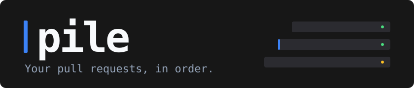

<h1 align="center">
  
</h1>

<p align="center">
  A terminal PR board for GitHub.<br>
  Your PRs, review requests, and CI status across repositories — in one place.
</p>

<p align="center">
  <a href="#get-started">Get started</a> ·
  <a href="#make-the-board-yours">Configuration</a> ·
  <a href="https://barspielberg.github.io/pr-pile/">Documentation</a>
</p>

<p align="center">
  <picture>
    <source media="(prefers-reduced-motion: reduce)" srcset="docs/public/demo-poster.png">
    
  </picture>
  <br>
  <sub>One PR per line. Your rules decide what comes first.</sub>
</p>

## A board that follows your priorities

- **Put your work in order.** Group PRs with GitHub search queries: yours first,
  review requests next, everything else after. Each PR appears once, under the
  first matching rule.
- **See what needs attention.** Check counts and review state stay on the row.
  Press `d` for failing checks, conflicts, unresolved conversations, reviewers,
  and size.
- **Keep your place.** Move one line at a time. Search highlights matches in
  place, keeping the rest of the board visible.
- **Follow work across repositories.** Bring several repos into one board,
  group stacked PRs into chains, and watch PRs for changes.
- **Use your own tools.** Open PRs in the browser, copy links, or bind shell
  commands to keys for your editor, worktree manager, or review tool.

## Get started

Requires **macOS or Linux**, [GitHub CLI](https://cli.github.com/) installed
and logged in, and **Go 1.24.2+**. pile uses your existing `gh` authentication.

On Linux, install `xdg-open` (usually packaged as `xdg-utils`) to open PRs in
your browser. Copying needs `wl-copy` (`wl-clipboard`) on Wayland or `xclip` /
`xsel` on X11. These integrations require a graphical desktop session; macOS
uses the built-in `open` and `pbcopy`.

```sh
go install github.com/barspielberg/pr-pile/cmd/pile@latest
```

From a local checkout of a GitHub repository, run:

```sh
pile
```

On first run, pile detects that repository and writes a commented starter
config to `~/.config/pile/config.yml`. The board starts with four sections:
**Mine**, **Needs my review**, **Involved**, and **All open**.

If your shell cannot find `pile`, add Go's binary directory (`$(go env GOPATH)/bin`
by default) to your `PATH`.

<details>
<summary>Build from a checkout</summary>

```sh
git clone https://github.com/barspielberg/pr-pile
cd pr-pile
make install
```

`make install` builds, tests, and vets the code before installing.

</details>

### A few keys to get around

| Key | Action |
| --- | --- |
| `j` / `k` or `↓` / `↑` | Move between rows |
| `h` / `l` or `←` / `→` | Jump between sections |
| `enter` | Open the PR in your browser |
| `d` | Show PR details |
| `/` then `n` / `N` | Search, then jump between matches |
| `space` / `v` | Select a PR / select a range |
| `y` / `Y` | Copy PR URLs / open the copy menu |
| `m` | Watch selected PRs for changes |
| `?` / `q` | Help / quit |

[All key bindings →](https://barspielberg.github.io/pr-pile/reference/keys/)

## Make the board yours

Edit `~/.config/pile/config.yml` to add repositories and reorder the rules.
This example uses the four starter rules:

```yaml
repos:
  - name: owner/name
  # - name: owner/another-repo

refresh: 3m

rules:
  - name: Mine
    query: author:@me
    tree: true       # group stacked PRs into chains
    limit: 50

  - name: Needs my review
    query: review-requested:@me -review:approved
    author: true     # show author initials
    limit: 50

  - name: Involved
    query: involves:@me -author:@me
    author: true
    limit: 20

  - name: All open
    query: draft:false
    author: true
    limit: 20
```

Queries use GitHub search syntax. pile adds the repositories and
`is:pr is:open` automatically. **Rule order is priority:** a PR matching both
“Mine” and “All open” appears only in “Mine”. Move a rule up to give it priority.

[Rules and ordering](https://barspielberg.github.io/pr-pile/guide/rules/) ·
[Team boards](https://barspielberg.github.io/pr-pile/guide/team-board/) ·
[Custom actions](https://barspielberg.github.io/pr-pile/guide/actions/)

## Go further

| I want to… | Read |
| --- | --- |
| Set up pile or troubleshoot first run | [Getting started](https://barspielberg.github.io/pr-pile/getting-started/install/) |
| Understand the row symbols and check counts | [Reading the board](https://barspielberg.github.io/pr-pile/guide/reading-the-board/) |
| Look up a setting or key | [Config reference](https://barspielberg.github.io/pr-pile/reference/config/) · [Keys](https://barspielberg.github.io/pr-pile/reference/keys/) |
| Build pile or contribute a change | [Contributing](https://barspielberg.github.io/pr-pile/contributing/) |

## Project status

pile is a personal tool at **0.x**, with no tagged releases yet. Tested on
macOS and Linux (Wayland and XWayland), with builds and automated tests on
Linux. Install from source today; Homebrew is planned after the first release.
Built-in write actions and a preview pane are not implemented. The
[documentation](https://barspielberg.github.io/pr-pile/) tracks `main`.

## License

Copyright (c) 2026 Bar Spielberg.

Code, including the documentation site's source code and code examples, is
licensed under the [MIT License](LICENSE).

Documentation prose and media in `README.md`, `docs/src/content/docs/`,
and `docs/public/` are licensed under
[Creative Commons Attribution 4.0 International (CC BY 4.0)](LICENSE-docs).
Attribution: Bar Spielberg, [pile](https://github.com/barspielberg/pr-pile).
Third-party material retains its original license.
