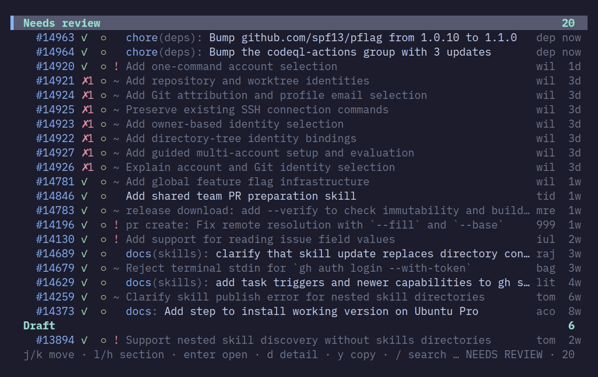

# pile

A terminal PR board for GitHub. Rules are the board; one keypress is one line.

pile fetches every open PR for a repo and renders each as one line, ordered by
rules you write. It shows the checks and review state that decide what to do
next, opens PRs in the browser, and gets out of the way between uses.

<p align="center">
  
</p>

## Install

macOS and Linux; `gh` installed and logged in; Go 1.24+ to build.
On Linux, browser opening needs `xdg-open` (xdg-utils); copying needs
`wl-copy` (wl-clipboard) on Wayland or `xclip` / `xsel` on X11.

```sh
go install github.com/barspielberg/pr-pile/cmd/pile@latest
```

`brew install barspielberg/tap/pile` follows the first release. To build from a
checkout instead: `git clone https://github.com/barspielberg/pr-pile && cd pr-pile && make install`.

## First run in 60 seconds

Run `pile` inside a checkout of a GitHub repo.

1. First run infers the repo with `gh` and writes a commented starter config to
   `~/.config/pile/config.yml`.
2. Edit the `repos:` list to cover your repositories and
   keep the four default rules.
3. `j`/`k` move · `enter` opens · `d` detail · `/` search · `?` help · `q` quit.

```yaml
repos:
  - name: owner/name
    path: ~/Repos/owner/name
refresh: 3m

rules:
  - name: Mine
    query: author:@me
    tree: true      # group stacked PRs into a chain
    limit: 50
  - name: Needs my review
    query: review-requested:@me -review:approved
    author: true    # show the author's initials
  - name: Involved
    query: involves:@me -author:@me
  - name: All open
    query: draft:false
    limit: 20
```

## What it does

- **Rules are the board.** Each section is a GitHub search query, and a PR is
  shown under the *first* rule that matches it — so ordering is the
  configuration.
- **One keypress, one line.** Every row is exactly one line, so scrolling is
  steady and predictable; a section header is a position the cursor can sit on.
- **Fetched in parallel, revealed in order.** Rules load together, but a
  section draws only once everything above it has resolved, so a slow rule
  cannot reorder the board.
- **Checks and review state on the row.** Passing and failing checks are counted, and `d` names
  failures in a per-PR overlay with conflicts, unresolved
  conversations, reviewers and size.
- **Search without moving the board.** `/` highlights matches in place — the PR
  number, the title as drawn, and the author initials.
- **Select and watch.** `space` selects a PR, `v` selects a range, `Y` opens
  the copy menu, `m` watches for changes, and `S` opens a native GitHub stack.
- **Your own keys.** Bind shell commands to keys; run them in the background or
  hand over the terminal. No actions are bound by default.

## Docs

The site is the manual: <https://barspielberg.github.io/pr-pile/>.

- [Getting started](https://barspielberg.github.io/pr-pile/getting-started/install/) — install and first run
- [Guides](https://barspielberg.github.io/pr-pile/guide/rules/) — rules, reading the board, search, detail, actions
- [Reference](https://barspielberg.github.io/pr-pile/reference/config/) — config, rules, actions, keys, CLI

## Status

A personal tool at 0.x with no tagged releases; the docs track `main`. Tested
on macOS and Linux (Wayland and XWayland), with build and automated tests on
Linux. Linux desktop integrations require the tools listed above. Supports
multiple repos, selection, watches and native GitHub stacks.
Not built: write actions and a preview pane.
